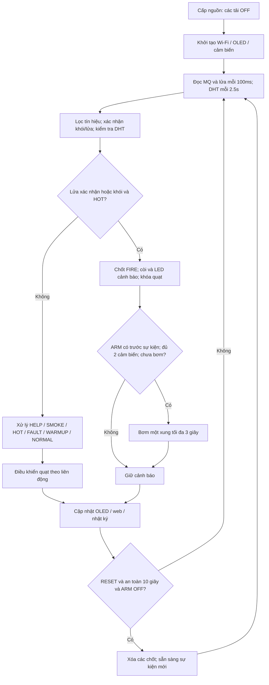

# IOT102 FireGuard — Mô hình giám sát khói, lửa và nhiệt độ

Thiết kế cho môn học theo mục tiêu người dùng mô tả; chưa đối chiếu rubric riêng của giảng viên IOT102. Dùng ESP32, MQ-2, DHT11, cảm biến lửa, relay hai kênh, bơm **5V DC**, quạt **5V DC** đã có. Không dùng SIM, SMS hoặc cuộc gọi. Wi-Fi nội bộ cung cấp phần kết nối IoT: điện thoại xem số đo và trạng thái trực tiếp từ ESP32.

**Phạm vi:** mô hình học tập trên bàn. Bơm nước là mô phỏng cơ cấu chấp hành, không phải giải pháp chữa cháy thực tế. Không dùng cho đám cháy điện, dầu/mỡ, hóa chất hay khí dễ cháy; không phun nước lên mạch. Không phát tán gas để thử MQ-2. Quạt trong thiết kế dùng làm mát bình thường, không làm hệ thống hút khói khi cháy.

## 1. Giả định phần cứng cần xác nhận

- ESP32 **DevKit dùng ESP32-WROOM-32 cổ điển**, chọn board `ESP32 Dev Module`. Không dùng nguyên bảng chân này cho C3/S2/S3. Kiểm tra chữ in trên module trước khi đấu.
- MQ-2 là **module** có VCC, GND, AO, DO; cảm biến lửa là module có VCC, GND, DO (có thể thêm AO). Cảm biến rời cần mạch khác.
- Relay hai kênh là **module đã có transistor/diode bảo vệ cuộn dây**, nguồn 5V, IN1/IN2 **kích mức LOW**, nhận được kéo xuống GND, dòng IN không quá 10mA mỗi kênh. Không áp dụng cho relay rời, module kích HIGH hoặc có cấu trúc chân khác.
- Hai transistor ngoài Q1/Q2 kéo LOW chân IN, giúp ESP32 không tiếp xúc mức 5V trên chân relay. Vì thế **GPIO HIGH = tải ON**, khác với cách nối thẳng GPIO vào IN.
- DHT11/module DHT11 chạy được 3.3V với dây ngắn theo tài liệu Aosong V1.3. Nếu module cụ thể ghi chỉ 5V, phải kiểm tra lại và dùng chuyển mức hai chiều cho DATA; không tự cấp 5V rồi nối DATA trực tiếp ESP32.
- Bơm và quạt đã được người dùng xác nhận 5V; dòng khởi động và model relay chưa rõ. Các giá trị nguồn, cầu chì và diode phải kiểm tra theo tải thật.

## 2. Danh sách linh kiện

Kiểm tra kit trường trước khi mua: LED, điện trở, breadboard, nút và jumper có thể đã có.

| Linh kiện cần bổ sung nếu chưa có | Số lượng | Yêu cầu / mục đích |
|---|---:|---|
| OLED I2C SSD1306 128×64, 0.96 inch | 1 | Module hỗ trợ **3.3V**, địa chỉ mặc định 0x3C; không chọn SH1106 cho code hiện tại |
| Module chuyển mức logic hai chiều BSS138 3.3V↔5V, 4 kênh | 1 | Dùng 1 kênh cho DO cảm biến lửa; cấp cả HV=5V và LV=3.3V, không dùng để cấp nguồn tải |
| Buzzer **active** 5V hai chân | 1 | Loại tự kêu khi cấp DC, dòng ≤20mA; không dùng loa/passive buzzer thay trực tiếp |
| LED đỏ, LED xanh | Mỗi màu 1 | Cảnh báo và trạng thái |
| Nút nhấn thường hở | 2 | HELP và RESET |
| Công tắc SPST ON/OFF | 1 | ARM cho phép bơm mô phỏng |
| NPN PN2222A / 2N2222A | 3 | Q1/Q2 giao tiếp relay; Q3 đóng cắt buzzer; **đọc datasheet đúng vỏ để xác định B/C/E** |
| Điện trở 1kΩ, ¼W | 3 | Nối GPIO đến base Q1/Q2/Q3 |
| Điện trở 100kΩ, ¼W | 3 | Kéo base Q1/Q2/Q3 xuống GND để tắt khi ESP32 reset |
| Điện trở 10kΩ, ¼W, 1% | 3 | 1 con chia áp MQ, 2 con kéo IN relay lên 5V |
| Điện trở 15kΩ, ¼W, 1% | 1 | Nửa dưới bộ chia áp MQ |
| Điện trở 4.7kΩ | 1 | Kéo DATA DHT11 lên 3.3V nếu module chưa có sẵn |
| Điện trở 330Ω | 2 | Hạn dòng hai LED |
| Diode Schottky SS34 hoặc 1N5822 | 2 | Mắc ngược song song mỗi tải DC; mẫu cho tải có dòng nằm trong định mức diode; kiểm tra dòng thực tế |
| Tụ gốm 100nF | 3 | Lọc ADC, rail 5V logic và rail 5V motor |
| Tụ điện 470µF ≥10V | 1 | Rail 5V logic, chú ý cực |
| Tụ điện 1000µF ≥10V | 1 | Rail motor gần relay/tải, chú ý cực |
| Nguồn 5V ổn áp cho logic | 1 | Đề xuất adapter USB hai cổng **5V tổng ≥2A**, đủ dòng mỗi cổng; một cổng cấp ESP32 USB, cổng kia ra rail cảm biến/relay |
| USB breakout đầu nguồn, dây nguồn phù hợp | 1 bộ | Lấy 5V/GND cho rail logic, không tháo adapter điện lưới |
| Nguồn 5V ổn áp riêng cho bơm/quạt | 1 | **3A là mức khởi điểm tham khảo**, chỉ chọn sau khi kiểm tra dòng khởi động tổng của tải |
| Công tắc nguồn tải, đế cầu chì + cầu chì | 1 bộ | Ngắt tải; chọn định mức theo tải/dây, không mặc định cầu chì 3A cho mọi mô hình |
| Breadboard, jumper, domino, dây tải, perfboard | 1 bộ | Dùng breadboard cho tín hiệu; đường dòng motor dùng dây/đầu nối riêng, không qua breadboard |
| Ống mềm, bình chứa, khay hứng nước | 1 bộ | Khớp đường kính bơm, chống bắn nước về phần điện |
| Cáp USB dữ liệu đúng đầu ESP32 | 1 | Nạp chương trình |
| Đồng hồ vạn năng | 1 nếu chưa có | Xác nhận 5V, 3.3V, chân transistor, mức AO sau chia áp và DO sau chuyển mức |

**Không cần mua:** Arduino Uno, module SIM800, SIM điện thoại, bộ hạ áp 12V→5V trong bản thiết kế này. Không mua LCD 1602 I2C 5V để thay thẳng OLED: phần điện và thư viện khác nhau.

Chưa báo tổng giá vì chưa xác định kit đã có gì và dòng tải; danh sách trên là quy cách mua, không phải báo giá.

## 3. Nghiệp vụ và quy tắc điều khiển

Các ngưỡng sau là **ngưỡng thử nghiệm do dự án chọn**, không phải chuẩn báo cháy hay mức khí an toàn.

| Nghiệp vụ | Quy tắc trong code |
|---|---|
| Khởi động | Relay/buzzer OFF; ESP32 phát Wi-Fi, bắt đầu đọc cảm biến. ARM phải được thấy ở OFF ít nhất một lần sau boot để mở khóa bơm. |
| Làm nóng MQ-2 | Chờ 180 giây mỗi lần bật nguồn trước khi dùng MQ để quyết định. Thời gian này cần tăng nếu module chưa ổn định; **không thay thế bước conditioning ban đầu ≥48 giờ** theo hãng. |
| Theo dõi khói/khí | Đọc AO qua chia áp trên ADC1 GPIO34. Lấy trung bình 16 mẫu, lọc EMA; bật cờ khi ≥1200mV, bỏ cờ khi ≤1000mV. Sau 1.5 giây liên tục mới xác nhận SMOKE. |
| Phát hiện lửa | DO active LOW qua module chuyển mức BSS138, liên tục 0.8 giây thì xác nhận FLAME. Nếu module active HIGH, đổi `FLAME_ACTIVE_LOW`. |
| Nhiệt độ cao | Đọc DHT11 mỗi 2.5 giây. HOT khi ≥40°C; hết HOT khi ≤37°C. Giữa 37–40°C giữ trạng thái trước đó. |
| Độ ẩm | Hiển thị tham khảo; không dùng làm điều kiện kết luận cháy. |
| Cảnh báo khói/khí | Khói được xác nhận làm LED đỏ sáng, buzzer kêu ngắt quãng, OLED/web hiện SMOKE. Không kết luận riêng MQ-2 là cháy. |
| Cảnh báo cháy | **FLAME hoặc (SMOKE và HOT)** → chốt FIRE, kể cả khi tín hiệu sau đó mất. Lửa vẫn được giám sát lúc MQ đang làm nóng. |
| Quạt | Chỉ bật khi MQ sẵn sàng, DHT tốt, HOT và không có tín hiệu khói/lửa, không có FIRE/HELP đã chốt. Tín hiệu khói/lửa sơ bộ đã khóa quạt, không chờ xác nhận xong. |
| Bơm mô phỏng | Chỉ khi ARM đã bật **trước lúc sự kiện FIRE bắt đầu**, MQ sẵn sàng, DHT không lỗi, FLAME được xác nhận và có thêm SMOKE hoặc HOT. Có thể đợi tín hiệu thứ hai trong cùng sự kiện; chỉ chạy **một xung tối đa 3 giây**. |
| Ngắt bơm | Hết 3 giây, ARM OFF, mất tín hiệu lửa sơ bộ hoặc lỗi DHT → dừng. Không tự chạy lặp trong cùng sự kiện. |
| HELP | Nhấn nút → chốt HELP, cảnh báo tại chỗ và web. HELP không tự kích hoạt bơm. Nếu có FIRE đồng thời thì màn hình ưu tiên FIRE nhưng cờ HELP vẫn còn. |
| RESET | Nhấn khi **ARM OFF**, MQ đã sẵn sàng, DHT tốt, không khói/lửa/HOT liên tục 10 giây. Nếu không đủ điều kiện, giữ cảnh báo và ghi RESET_REJECTED. |
| Lỗi DHT | Chưa đọc được, 3 lần đọc lỗi liên tiếp hoặc quá 10 giây không có mẫu tốt → FAULT; khóa quạt/bơm. Khói và lửa vẫn được giám sát độc lập. |
| Giám sát Wi-Fi | Điện thoại nối trực tiếp Wi-Fi ESP32; trang web đọc trạng thái khoảng mỗi giây. Không cần mạng trường, cloud hay Internet. |
| Lịch sử | Lưu 20 sự kiện đổi trạng thái/bật tắt tải/reset gần nhất trong RAM, thời gian tương đối từ boot. Mất khi mất điện/reset ESP32. |

**Thứ tự trạng thái hiển thị:** FIRE → HELP → SMOKE → HOT → FAULT → WARMUP → NORMAL. Web vẫn hiển thị từng cờ và tình trạng DHT/OLED để thấy các sự kiện đồng thời.

**Giới hạn chẩn đoán:** chưa tự phát hiện được mọi trường hợp đứt dây MQ/flame, relay dính, bơm chạy khô hoặc quạt kẹt; không có cảm biến phản hồi tải/mực nước. Trạng thái PUMP/FAN trên web là **lệnh điều khiển**, không chứng minh tải thực sự chạy. Mất Wi-Fi không dừng giám sát tại chỗ; sự cố nguồn ESP32 thì không còn giám sát. Chốt cảnh báo hiện chỉ nằm trong RAM.

## 4. Luồng hoạt động



Luồng bơm có hai lớp phân biệt: **đủ điều kiện báo cháy** và **đủ điều kiện trình diễn phun nước**. Chỉ nhìn thấy lửa đã báo cháy ngay sau thời gian xác nhận, nhưng chưa tự phun nước nếu không có tín hiệu thứ hai và ARM hợp lệ.

## 5. Sơ đồ và bảng đấu nối

Mở `01_so_do_cam_bien.png` và `02_so_do_cong_suat.png`; bản SVG cùng tên phóng to không vỡ. Đây là **sơ đồ nguyên lý ở mức module với nhãn mạng**, phong cách khung bản vẽ như ảnh mẫu, không phải file EasyEDA/PCB hay vị trí chân vật lý trên breadboard. Các nhãn net giống nhau trên hai tờ được nối điện với nhau; không suy ra vị trí chân từ hình vẽ.

### 5.1. Nguồn

1. **Nguồn logic 5V:** một cổng USB cấp ESP32 qua cổng USB; cổng kia qua breakout cấp MQ-2, cảm biến lửa, relay và buzzer. GND nguồn cảm biến/relay nối ESP32 GND. Đầu 3V3 của ESP32 cấp DHT11/OLED.
2. **Không nối rail +5V_LOGIC ngoài vào VIN/5V của ESP32 trong thiết kế này.** Khi nạp, chuyển USB ESP32 từ adapter sang máy tính; rail module vẫn có thể do adapter cấp. Chỉ nối chung GND, không nối hai đường 5V dương USB với nhau.
3. **Nguồn motor 5V riêng:** +5V qua công tắc và cầu chì tới COM1/COM2; NO1 tới bơm+, NO2 tới quạt+; hai cực âm tải về MOTOR_GND. NC để trống.
4. Phần tải qua tiếp điểm relay không cần nối MOTOR_GND với LOGIC_GND. Giữ hai mạng riêng trong bản vẽ; nguồn cách ly sẵn theo adapter. Tất cả GND phía ESP32/cảm biến/relay IN/transistor phải chung LOGIC_GND.
5. Mỗi diode tải: **đầu có vạch cathode vào cực + của motor**, anode vào cực – motor; diode luôn ở phía tải sau tiếp điểm. Không mắc diode xuôi ngang nguồn.
6. Tụ 470µF + 100nF ngang rail logic, tụ 1000µF + 100nF ngang rail motor. Tụ điện cực + vào +5V, cực – vào GND tương ứng. Tụ giúp lọc, không thay được nguồn đủ dòng.
7. Chọn nguồn motor theo `I_nguồn ≥ tổng dòng khởi động lớn nhất có thể đồng thời + dự phòng`. Kiểm tra thêm dòng DC/khả năng chịu tải motor của tiếp điểm relay, dây, đầu nối, công tắc và cầu chì. Dù phần mềm ngăn một số tổ hợp, thiết kế nguồn không nên dựa hoàn toàn vào phần mềm.

### 5.2. Chân ESP32

| Chân | Nối tới | Chi tiết |
|---|---|---|
| GPIO34 / ADC1_CH6 | AO MQ-2 qua chia áp | Không nối AO 5V trực tiếp; DO MQ-2 không sử dụng |
| GPIO33 | LV1 BSS138; HV1 nối DO cảm biến lửa | AO cảm biến lửa không sử dụng |
| GPIO4 | DATA DHT11 | VCC DHT11 = 3.3V; kéo DATA lên 3.3V qua 4.7k nếu chưa có |
| GPIO21 | SDA OLED | OLED VCC = 3.3V |
| GPIO22 | SCL OLED | Không kéo SDA/SCL lên 5V |
| GPIO26 | Base Q1 qua 1k | Collector Q1 → IN1 relay → bơm |
| GPIO27 | Base Q2 qua 1k | Collector Q2 → IN2 relay → quạt |
| GPIO25 | Base Q3 qua 1k | Collector Q3 → buzzer–; buzzer+ → +5V_LOGIC |
| GPIO18 | 330Ω → anode LED đỏ | Cathode → LOGIC_GND |
| GPIO19 | 330Ω → anode LED xanh | Cathode → LOGIC_GND |
| GPIO13 | Nút HELP thường hở | Đầu kia GND; dùng INPUT_PULLUP |
| GPIO14 | Nút RESET thường hở | Đầu kia GND; dùng INPUT_PULLUP |
| GPIO32 | Công tắc ARM | Đầu kia GND; đóng = cho phép, mở = tắt |
| 3V3 | OLED và DHT11 | Chỉ cấp phần tải nhỏ 3.3V |
| GND | LOGIC_GND | Chung MQ, flame, DHT, OLED, relay điều khiển, Q1/Q2/Q3 |

**Chia áp AO MQ-2:**

```text
AO MQ-2 ── Rtop 10kΩ ──┬── GPIO34
                                 │
                              Rbottom 15kΩ
                                 │
                             LOGIC_GND
```

`V_GPIO = V_module × 15/(10+15) = 0.6 × V_module`. Đầu ra 5V được hạ khoảng 3.0V. Tụ 100nF chỉ thêm giữa **GPIO34 và LOGIC_GND** để lọc ADC. Đo thật trước khi cắm GPIO. Không tính AO MQ thành ppm từ công thức chia áp.

**Chuyển mức DO cảm biến lửa:** DO → HV1 của module BSS138, LV1 → GPIO33, HV → +5V_LOGIC, LV → 3V3 ESP32, GND → LOGIC_GND. Các kênh không dùng để trống. Module này giữ nguyên cực tính tín hiệu, không đảo LOW/HIGH. Dùng chuyển mức thay vì chia áp cho DO vì đầu ra một số module cảm biến là open-collector với điện trở kéo lên yếu. BSS138 cũng không phải bộ ổn áp, không dùng đầu LV để cấp nguồn cho cảm biến.

**Q1 và Q2, mỗi kênh:**

```text
GPIO26/27 ── 1k ── B (NPN)
                       │
                     100k
                       │
                  LOGIC_GND
E (NPN) ───────── LOGIC_GND
C (NPN) ───────── IN1/IN2 relay
IN1/IN2 ── 10k ── +5V_LOGIC
Relay VCC ─────── +5V_LOGIC
Relay GND ─────── LOGIC_GND
```

Nếu relay có JD-VCC/VCC: chỉ theo cấu hình common-ground 5V được nhà sản xuất module cho phép; jumper thông thường nối nguồn coil và logic, nhưng cần xem module thật. Không dùng tên chân hoặc thứ tự cọc trong ảnh mẫu để suy ra thứ tự trên module đang có. Module không kích LOW hoặc cần dòng IN vượt khả năng interface phải đổi mạch.

Q3 giống mạch base/emitter trên, collector vào buzzer–, buzzer+ vào 5V logic; không cần điện trở pull-up collector 10k. Chọn active piezo buzzer; buzzer từ tính có thể cần thêm diode theo nhà sản xuất.

## 6. Code và cách nạp

### File

- `FireGuard/FireGuard.ino`: cấu hình, đọc cảm biến, Wi-Fi AP, web JSON, OLED, log.
- `FireGuard/ControlLogic.h`: bộ máy trạng thái và liên động bơm/quạt; giữ cùng thư mục với `.ino`.
- `CHECKS.md`: kết quả biên dịch và kiểm tra logic thực tế của gói.

### Arduino IDE

1. Cài Arduino IDE và board package **esp32 by Espressif Systems**. Gói được kiểm tra với core **3.3.12**, board **ESP32 Dev Module**.
2. Trong Library Manager cài **DHT sensor library by Adafruit**, **Adafruit Unified Sensor**, **Adafruit SSD1306**, **Adafruit GFX Library**, **Adafruit BusIO**. Đồng ý cài dependency. `WiFi`, `WebServer`, `Wire` đi kèm core ESP32, không cài thư viện WiFi dành cho board khác.
3. Mở `FireGuard/FireGuard.ino`; IDE tự thấy tab `ControlLogic.h`. Chọn đúng cổng COM. Upload trước khi đấu tải; nếu board cần thì giữ BOOT theo quy trình của board.
4. Mở Serial Monitor **115200 baud**. Xác nhận DHT/OLED và giá trị MQ. Mặc định OLED địa chỉ **0x3C**, không có OLED thì chương trình vẫn chạy và web báo `oled_ok=false`.
5. Điện thoại nối Wi-Fi **IOT102-FireGuard**, mật khẩu **demo102esp32**. Chọn tiếp tục dùng mạng dù không có Internet, rồi mở **http://192.168.4.1** bằng HTTP. Nếu điện thoại tự chuyển mạng, tạm tắt tính năng tự đổi sang dữ liệu di động.
6. Đổi mật khẩu Wi-Fi trong code cho nhóm của bạn. Bản này phục vụ mạng AP nội bộ, chưa có cloud/MQTT hay truy cập từ xa qua Internet. Chưa có lệnh bật bơm từ trình duyệt; thao tác tải phải qua điều kiện và công tắc vật lý.

### Thông số có thể chỉnh ở đầu `.ino`

| Hằng số | Mặc định | Ý nghĩa |
|---|---:|---|
| `MQ_WARMUP_MS` | 180000 | 180 giây ổn định mỗi boot, điều chỉnh theo thử nghiệm |
| `SMOKE_ON_MV` | 1200 | Ngưỡng bật sau chia áp, phải hiệu chỉnh |
| `SMOKE_OFF_MV` | 1000 | Ngưỡng tắt; luôn nhỏ hơn ngưỡng bật |
| `TEMP_ON_C` | 40 | Nhiệt độ bật HOT, chỉ phục vụ mô hình |
| `TEMP_OFF_C` | 37 | Nhiệt độ bỏ HOT |
| `FLAME_ACTIVE_LOW` | true | Đổi nếu module lửa xuất HIGH khi phát hiện |
| `AP_PASSWORD` | demo102esp32 | Mật khẩu Wi-Fi ≥8 ký tự |

Thời gian xác nhận khói/lửa ở `sample()`; thời gian bơm 3000ms và reset 10000ms ở `ControlLogic.h`. Nếu đổi thời gian, cập nhật báo cáo và kiểm thử tương ứng.

### Hiệu chỉnh MQ-2

1. Đặt module ở nơi thoáng, không sát DHT11 (heater MQ làm nóng số đo), không trong hộp kín. Conditioning ban đầu theo tài liệu hãng, không để bộ thử nghiệm thiếu giám sát.
2. Cấp 5V ổn định, đợi tín hiệu ổn định. Ghi `mq_mV` ở không khí sạch ít nhất vài phút, xác định biên dao động; không tự coi hết 180 giây là đã đạt chuẩn ổn định.
3. Đo đáp ứng bằng phương pháp thử được giảng viên cho phép, tránh xả gas/hóa chất dễ cháy. Chọn ngưỡng ON cao hơn biên nền và OFF thấp hơn ON, kiểm tra lại nhiều lần.
4. Không tự lấy baseline mới mỗi boot: nếu khởi động trong môi trường ô nhiễm, auto-calibration có thể coi mức nguy hiểm là bình thường. Mã này dùng ngưỡng cố định do nhóm hiệu chỉnh.
5. MQ-2 phản ứng nhiều loại khí và khói; **không phân biệt chính xác loại khí, không đo CO₂ và không cung cấp ppm đáng tin nếu chưa có mạch/hiệu chuẩn phù hợp**. AO chỉ đang được hiển thị bằng mV tại chân ESP32.

## 7. Trình tự lắp và kiểm thử trên bàn

1. **Tắt mọi nguồn.** Đọc pinout phần cứng thật, kiểm tra transistor B/C/E, cực tụ và diode. Không dựa vào màu jumper.
2. Đấu nguồn logic + ESP32 + DHT/OLED, chưa cắm AO/DO vào ESP32. Đo 5V, 3.3V, GND. Kiểm tra đầu ra chia áp MQ và LV1 chuyển mức flame đều trong mức cho ESP32; xác nhận LV1 lên khoảng 3.3V khi DO ở HIGH.
3. Đấu cảm biến vào đúng GPIO, nạp code. Giữ ARM OFF. Xác nhận nhiệt độ/độ ẩm, không có báo lửa giả; điều chỉnh biến trở module flame nếu cần và xác nhận active LOW/HIGH.
4. Đấu giao tiếp Q1/Q2, cấp relay **chưa nối motor**. Kiểm tra relay không hút ở boot/reset/mất USB. Dùng đồng hồ kiểm tra COM–NO đóng đúng theo lệnh. Nếu boot hút relay, dừng lại và kiểm tra module/driver, không nối bơm.
5. Đấu nguồn motor riêng, cầu chì, diode đúng cực, quạt và bơm. Đặt bơm theo hướng dẫn loại bơm (nhiều bơm mini cần ngập nước), ống ra vào khay. Tách toàn bộ nước khỏi mạch, không phun vào nến hay điện tử khi demo.
6. Kiểm tra từng nghiệp vụ theo bảng dưới. Có thể thử logic bằng việc thay đổi tạm ngưỡng nhiệt độ rồi nạp lại; ghi rõ đây là **mô phỏng điều kiện**, không phải hiệu chuẩn cảm biến hay thử cháy thật.

| Ca thử | Thao tác | Kết quả mong đợi |
|---|---|---|
| Khởi động | ARM OFF, cấp nguồn | Bơm/quạt OFF; DHT chưa có mẫu có thể hiện FAULT ngắn, sau đó WARMUP |
| Kết nối | Nối AP và mở web | Số đo cập nhật, trang báo trực tuyến |
| Bình thường | Hết warmup, môi trường sạch | NORMAL, LED xanh |
| Nhiệt cao | Giảm tạm ngưỡng demo thấp hơn nhiệt độ phòng, không khói/lửa | HOT, quạt ON sau MQ ready; không bơm |
| Có lửa đơn lẻ | Test module bằng cách được giảng viên cho phép, không phun nước | FIRE sau khoảng 0.8 giây + chu kỳ lấy mẫu; quạt OFF; bơm OFF nếu không có corroboration/ARM |
| Có khói đơn lẻ | Tín hiệu MQ vượt ngưỡng đã hiệu chỉnh | SMOKE sau lọc và 1.5 giây; quạt OFF, bơm OFF |
| Hai tín hiệu và ARM OFF | Lửa + HOT hoặc lửa + khói | FIRE; bơm OFF |
| ARM bật muộn | Bật ARM sau khi FIRE đã chốt | Bơm vẫn OFF cho sự kiện đó |
| Một xung bơm | Reset an toàn; bật ARM trước; sau đó lửa + HOT/khói | Bơm ON tối đa 3 giây, dừng nếu mất lửa; không tự lặp |
| Ngắt khẩn bơm | Mở ARM khi bơm đang chạy | Bơm OFF ở vòng điều khiển tiếp theo; ngắt nguồn tải nếu cần ngắt vật lý |
| HELP | Nhấn HELP | Chốt HELP, buzzer/LED cảnh báo, không tự bơm |
| Reset không hợp lệ | RESET khi còn tín hiệu hoặc ARM ON | Không xóa chốt, log RESET_REJECTED |
| Reset hợp lệ | Hết các tín hiệu ≥10 giây, ARM OFF rồi nhấn RESET | Xóa FIRE/HELP, cho phép sự kiện mới |
| Lỗi DHT | Rút DATA trong khi test, không chập nguồn | Sau 3 lần đọc lỗi / timeout: web báo DHT lỗi, khóa quạt/bơm; lửa/khói vẫn được theo dõi |
| Mất Wi-Fi | Điện thoại ngắt AP | Chức năng tại chỗ vẫn chạy; trình duyệt báo dữ liệu có thể đã cũ |
| Tắt nguồn | Tắt nguồn ESP32 | Relay phải nhả nhờ driver OFF; không còn giám sát; log/chốt RAM mất |

Khoảng thời gian trên là thời gian phần mềm danh định, không phải đáp ứng thời gian thực được chứng nhận. Chưa kiểm tra thực tế trên bộ linh kiện của bạn.

## 8. Gợi ý trình bày bài IOT102

- Bài toán: phát hiện dấu hiệu khói/lửa/nhiệt cao, hiển thị và thông báo tại chỗ, người dùng xem qua Wi-Fi.
- Kiến trúc: **Sensors → ESP32/state machine → buzzer/LED/OLED/relay → local Wi-Fi dashboard**.
- Điểm giải thích: ADC1 khi chạy Wi-Fi; bảo vệ mức 3.3V; hysteresis tránh bật/tắt liên tục; debounce/xác nhận tín hiệu; chốt sự cố; bơm một xung; nguồn motor riêng.
- Minh chứng: ảnh sơ đồ, bảng chân, ngưỡng đã đo, bảng kiểm thử có kết quả thật, ảnh web và video demo các tình huống.
- Nếu rubric yêu cầu MQTT/cloud/database thì Wi-Fi AP nội bộ có thể chưa đủ; cần đối chiếu rubric trước khi chốt phạm vi.

## 9. Tài liệu kỹ thuật

- [Espressif ESP32 datasheet](https://documentation.espressif.com/esp32_datasheet_en.html): giới hạn điện và chức năng chân; GPIO ESP32 không nhận trực tiếp mức 5V.
- [Arduino-ESP32 ADC API](https://docs.espressif.com/projects/arduino-esp32/en/latest/api/adc.html): `analogReadMilliVolts`, attenuation; thiết kế dùng ADC1 GPIO34.
- [Arduino-ESP32 Wi-Fi API](https://docs.espressif.com/projects/arduino-esp32/en/latest/api/wifi.html): Soft-AP và HTTP server nội bộ.
- [Winsen MQ-2](https://www.winsen-sensor.com/product/mq-2.html): nguồn heater 5V, nhạy với khói/khí dễ cháy, conditioning ≥48 giờ.
- [Aosong DHT11 V1.3](https://www.aosong.com/userfiles/files/media/DHT11-V1_3%E8%AF%B4%E6%98%8E%E4%B9%A6%EF%BC%88%E8%AF%A6%E7%BB%86%E7%89%88%EF%BC%89.pdf): 3.3–5.5V, chu kỳ lấy mẫu >2 giây, dùng dây ngắn ở 3.3V.
- [Adafruit DHT library](https://github.com/adafruit/DHT-sensor-library), [SSD1306 library](https://github.com/adafruit/Adafruit_SSD1306): thư viện dùng trong code.
- [SparkFun BSS138 logic level converter hookup guide](https://learn.sparkfun.com/tutorials/bi-directional-logic-level-converter-hookup-guide/all): HV=5V, LV=3.3V, tín hiệu qua các cặp HV1/LV1, GND chung.

Thiết kế dựa trên các họ linh kiện; chưa thể xác nhận tương thích từng module khi chưa biết model/ảnh thực tế ESP32, MQ-2, flame và relay. Không nên mua thêm nguồn hoặc đấu cấp điện theo giả định nếu nhãn module thực tế khác phần 1.
